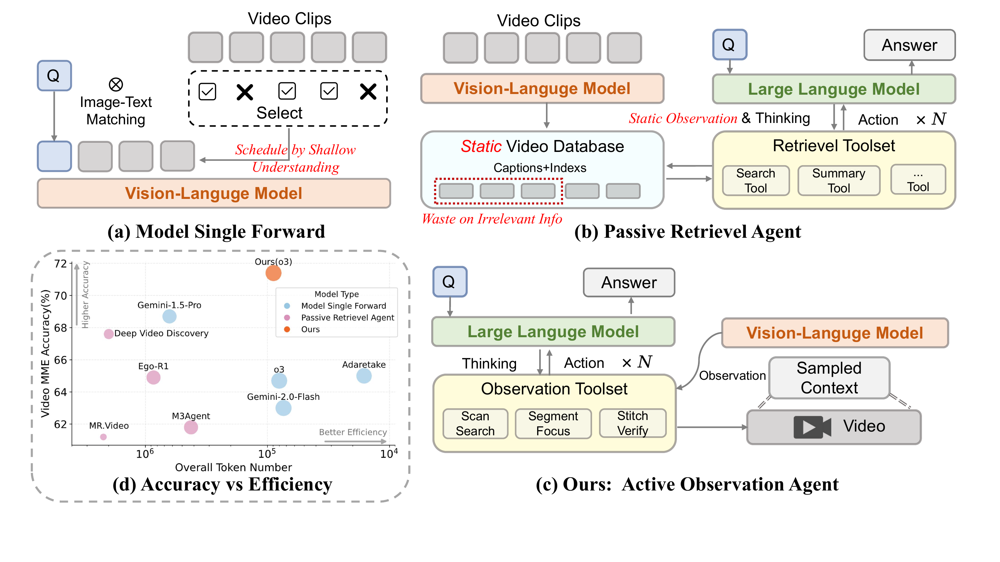
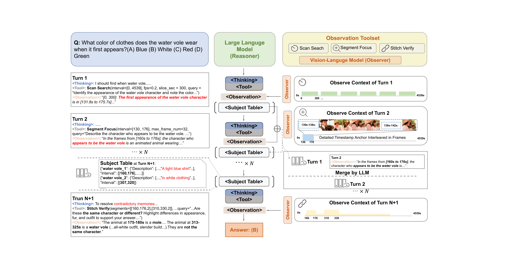

# LensWalk

**LensWalk: Agentic Video Understanding by Planning How You See in Videos**  
CVPR 2026 Highlight

[Project Page](https://likanchuan09171.github.io/LensWalk/) · [Paper PDF](assets/LensWalk_arxiv_2603.24558.pdf)

<p align="center">
  
  <br>
  <em>Figure 1. LensWalk actively plans what to observe from the source video instead of relying on a fixed context or a static retrieval database.</em>
</p>

LensWalk is an agentic framework for long-video understanding. Instead of feeding a model a fixed video context, LensWalk lets a language reasoner decide where and how densely to observe the video while solving a question. At each turn, the reasoner plans an observation action, calls a Vision-Language-Model observer tool, receives timestamped visual evidence, and continues reasoning with the accumulated observations.

The public release contains the LensWalk inference path, the VCS observation tools, tool configuration, benchmark readers for JSON/JSONL video QA data, and smoke tests. Training code and benchmark annotation files are not included.

## Method Overview

LensWalk organizes inference as a reason-plan-observe loop:

- **Reason**: an LLM planner interprets the question and accumulated evidence.
- **Plan**: the planner selects an observation tool and its temporal sampling parameters.
- **Observe**: a VLM observer receives only the sampled video subsegments requested by the tool call.
- **Continue**: timestamped observations, and optionally a subject registry, are fed back into later reasoning turns.

The released tool set includes:

- `scan_observer`: partitions a broad interval into slices and scans them in parallel.
- `segment_observer`: focuses on one continuous interval with denser local sampling.
- `stitched_observer`: stitches multiple non-contiguous intervals into one observer context for comparison or verification.
- `finish`: returns the final answer.

<p align="center">
  
  <br>
  <em>LensWalk schedules broad scan, focused segment observation, and stitched verification over the video timeline while maintaining timestamped evidence and subject memory.</em>
</p>

## Installation

```bash
conda create -n lenswalk python=3.10 -y
conda activate lenswalk
python -m pip install -U pip
pip install -e .
```

If video decoding fails on your machine, install the system FFmpeg package as well. OpenCV and Decord use the local video stack for some codecs.

## API Configuration

LensWalk uses one OpenAI-compatible endpoint for the planning agent and one OpenAI-compatible endpoint for the visual observation tools. They may point to the same service.

```bash
export OPENAI_API_KEY="your-agent-key"
export OPENAI_BASE_URL="https://api.openai.com/v1"

export TOOL_OPENAI_API_KEY="your-vision-tool-key"
export TOOL_OPENAI_BASE_URL="https://api.openai.com/v1"
export MLLM_BACKEND="gpt-4o-mini"
```

`OPENAI_API_KEY` / `OPENAI_BASE_URL` are used by the planner and open-ended answer judge. `TOOL_OPENAI_API_KEY` / `TOOL_OPENAI_BASE_URL` / `MLLM_BACKEND` are used by the visual observer tools.

## Data Format

Pass your own JSON/JSONL file with `--bench_name`. `video_path` can be absolute or relative to `--video_root`.

One JSONL item should follow this schema:

```json
{
  "id": "sample-001",
  "video_path": "videos/example.mp4",
  "duration": 180.0,
  "question": "Which object appears after the narrator introduces the experiment?",
  "options": [
    "A. A microscope",
    "B. A telescope",
    "C. A camera",
    "D. A compass"
  ],
  "answer": "B",
  "question_type": "multiple-choice"
}
```

Accepted aliases include `golden_answer` for `answer`, `choices` for `options`, and `video_path_abs` for `video_path`. If `options` or `choices` is present and `question_type` is not `open-ended`, the reader appends the options to the question text before inference.

## Run Inference

```bash
PYTHONPATH=. python eval/infer_bench_summ_vcs.py \
  --tool_config tool_configs/vcs_standard.yaml \
  --bench_name /path/to/your_videoqa.jsonl \
  --video_root /path/to/video/root/ \
  --model_name_or_path gpt-4.1 \
  --max_turns 5 \
  --batch_size 1 \
  --workers 2 \
  --data_start 0 \
  --data_end 10 \
  --limit_scan_calls True \
  --max_scan_calls 1
```

Outputs are written under `results/run_lods/...`, including conversations, tool-call logs, summary JSON, and tool-use CSV summaries.

## Subject Registry

Enable the optional subject registry with:

```bash
--subject_registry True
```

When enabled, visual observers return per-observation subject registries. LensWalk merges them into a global registry and injects the updated registry into later reasoning turns so the planner can keep persistent people, objects, and entities grounded across observations.

## Smoke Tests

The smoke tests create a tiny synthetic video and monkeypatch OpenAI clients with deterministic responses. They verify imports, benchmark loading, video frame extraction, planner tool calls, VCS dispatch, scoring, result writing, and subject-registry updates without real API keys.

```bash
PYTHONPATH=. python tests/mock_inference_smoke.py
PYTHONPATH=. python tests/mock_subject_registry_smoke.py
```

## Acknowledgements

We thank the authors of Ego-R1 and Deep Video Discovery for releasing their code repositories:

- Ego-R1: https://github.com/egolife-ai/Ego-R1
- Deep Video Discovery: https://github.com/microsoft/DeepVideoDiscovery

## Citation

```bibtex
@inproceedings{li2026lenswalk,
  title     = {LensWalk: Agentic Video Understanding by Planning How You See in Videos},
  author    = {Li, Keliang and Li, Yansong and Shen, Hongze and Liu, Mengdi and Chang, Hong and Shan, Shiguang},
  booktitle = {Proceedings of the IEEE/CVF Conference on Computer Vision and Pattern Recognition (CVPR)},
  year      = {2026}
}
```
